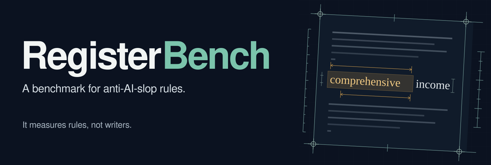

<p align="center">
  
</p>

<h1 align="center">RegisterBench</h1>

<p align="center">
  <strong>Five anti-AI-slop rulesets, one shared test, real financial filings.<br/>
  RegisterBench measures rules, not writers.</strong>
</p>

<p align="center">
  <a href="https://opensource.org/licenses/MIT"></a>
  <a href="https://www.python.org/"></a>
  <a href="https://nodejs.org/"></a>
  
  
  <a href="https://github.com/RZ-Logic/RegisterBench/actions/workflows/tests.yml"></a>
  
</p>

<p align="center">
  <a href="#-why-i-built-this">Why</a> •
  <a href="#%EF%B8%8F-the-measurement-principle">Principle</a> •
  <a href="#-where-is-the-judgment">Where is the Judgment?</a> •
  <a href="#-what-ships-in-v01">What Ships</a> •
  <a href="#-v012-results-finance-audit">Results</a> •
  <a href="#-the-executable-subset-gap">Executable-Subset Gap</a> •
  <a href="#-stack">Stack</a> •
  <a href="#-how-to-read-this-repo">How to Read</a> •
  <a href="#-reproduction">Reproduction</a> •
  <a href="#%EF%B8%8F-build-decisions--lessons-learned">Build Decisions</a> •
  <a href="#-limitations">Limitations</a> •
  <a href="#%EF%B8%8F-roadmap">Roadmap</a> •
  <a href="#-prior-art--acknowledgements">Prior Art</a>
</p>

---

## 🧭 Why I Built This

I'm an ACCA with audit roots who pivoted into AI automation architecture. Working in audit, you learn that *"the policy says X"* and *"the code does X"* are different sentences, and the second one is the only one that matters when the regulator shows up.

RegisterBench tests five anti-AI-slop rulesets, six implementations in all because one project ships two, on one register. A register is a writing context with its own conventions: financial disclosure is one, casual email and technical documentation are others. This release covers finance and audit writing. Every implementation runs over 10 seeded drafts carrying 122 hand-planted instances of 29 patterns, and over 111,313 words of real SEC filings written before ChatGPT existed. Three findings:

1. **The specification beats its own implementation.** `avoid-ai-writing` ships a prose ruleset for a model to read and a regex engine that implements part of the same catalog. Read by a model, the prose recalls 74.9% of the planted instances; the engine recalls 46.7%. The gap is 28.1 points on the published weighting and between 12.8 and 37.1 under every alternative weighting tested. Same repository, same commit, same rules. I found no earlier measurement of that distance.
2. **Word lists collide with regulated language.** On the real filings, Tier 1 `comprehensive` fires on `comprehensive income`, a term defined in FASB ASC 220, and Tier 1 `leverage`, which the ruleset itself scopes to the verb, fires on Caterpillar's "covenant leverage ratio", a contractually defined covenant. A filer cannot rewrite either. Measuring this needs to know which phrases are legally load-bearing, which is what my audit background is for.
3. **How a ruleset is run changes what it reports.** Through the API, as the protocol pins it, the four prose rulesets return an empty list for 13 to 17 of the 18 filings per run, 182 of 187 times with zero thinking tokens, while every synthetic draft gets findings. Run through an agent harness in v0.1.0, the same `stop-slop` rules flagged the filings about twenty times as often, including the auditor's opinion sentence "present fairly, in all material respects" (PCAOB AS 3101.08). On the API they flag that sentence only where it sits inside a seeded draft. Why the lists are empty is not something these data settle.

**On why measurement and not another editor.** The ecosystem already has capable editors. Of the five projects tested here, only `unslop` publishes benchmark numbers at all, and even its comparison table concedes that a competitor's blind human-preference result is *"not publicly measured"*. Fixtures written by a tool's developer do measure behavior; what they cannot do is rule out that developer's blind spots or show how a rule behaves on text nobody wrote for it. That is the gap this fills.

This project sits alongside a portfolio thesis on defensible AI in regulated finance:

- **[FinAgent OS](https://github.com/RZ-Logic/finagent-os)**: *governance.* SOX-defensible properties enforced as Postgres triggers and missing-by-design tool surfaces.
- **[regulated-rag](https://github.com/RZ-Logic/regulated-rag)**: *retrieval.* Citation grounding and refusal enforced in code rather than promised in prompts.
- **RegisterBench** (this repo): *measurement.* The same discipline turned outward, applied to somebody else's published claims.

---

## 🛡️ The Measurement Principle

> **A tool's own fixtures share its author's blind spots. Recall on planted ground truth and flag behavior on verifiably human text are two different questions, and a benchmark has to answer both.**

Recall alone rewards a ruleset for firing constantly. Flag density alone rewards one for never firing. Reported together, on ground truth planted by hand before any tool ran, they describe a tool honestly; neither is a verdict on its own.

The human corpus predates November 2022, so no flag on it can be an AI catch. That does not make every flag wrong as style advice, but a rule that fires densely on a 2020 10-K is encoding a style preference, not an AI signal.

**RegisterBench never claims or implies AI authorship of any text.** It has no authorship detector and produces no "AI risk" score. It measures rules against a manifest. Every planted instance was recorded in [`manifest.json`](seeded/finance-audit/manifest.json) at the moment it was written, with its exact span, pattern and tier, and [`verify_manifest.py`](scripts/verify_manifest.py) re-locates every span and fails loudly on drift.

---

## 🎯 Where is the Judgment?

Adapted from the *"Where is the AI?"* enumeration in [FinAgent OS](https://github.com/RZ-Logic/finagent-os). Every automated stage is deterministic except prompt-track detection. Two stages are human judgments, recorded when they were made so they can be audited, which is not the same as deterministic.

| # | Stage | Deterministic? | What it does |
|---|---|:-:|---|
| 1 | **Corpus acquisition** | ✅ | EDGAR submissions API by CIK, Item 7 and audit-opinion slicing, accession numbers in [`PROVENANCE.md`](corpora/finance-audit/PROVENANCE.md). |
| 2 | **Prose filtering** | ✅ | Drops numeric-majority and heading-fragment lines from flattened tables; `raw/` kept untouched. |
| **3** | **Seeding** | **📝 recorded judgment** | Patterns planted by hand into adapted filing text, never model-generated, every span recorded at write time. |
| 4 | **Manifest verification** | ✅ | Every span re-located, counts range-checked, pattern IDs validated. Exits nonzero on drift. |
| **5** | **Crosswalk** | **📝 recorded judgment** | 29 canonical patterns mapped to each tool's own rules, coded blind by two coders per tool at 98.9% agreement. Evidence per cell in [`coding_record.json`](crosswalk/coding_record.json). |
| 6 | **Code-track detection** | ✅ | `avoid-ai-writing` `analyzeText()` and `unslop` deterministic layer, both SHA-pinned. |
| **7** | **Prompt-track detection** | **❌ stochastic** | Ruleset files verbatim as the API `system` prompt, uniform detect-only instruction, `claude-sonnet-5` with thinking and effort at its defaults, N=3 per document on both corpora via the Message Batches API. |
| 8 | **Validation and matching** | ✅ | Responses with any malformed finding are rejected; quotes that occur nowhere in their document are reported and excluded; located spans matched to plants at 0.5 overlap, one finding per plant. |
| 9 | **Scoring** | ✅ | Recall by tier and pattern, flags per 1,000 words, term-of-art violations against a cited whitelist, run-to-run spread. |

Six deterministic stages, two recorded judgments, one stochastic stage bounded and reported with its spread.

> **The principle:** A benchmark whose own pipeline is stochastic cannot separate a tool's variance from its own. Isolate the stochasticity to the one stage that needs it, pin the model, run it N times, and publish the spread. Where a stage needs human judgment, record it when it is made and publish the record.

---

## 🧱 What Ships in v0.1

```
┌────────────────────────────────────────────────────────────────────────────┐
│                                                                            │
│   One seeded draft (fin-04, adapted from Delta's FY2020 10-K MD&A):        │
│                                                                            │
│     Base text        ← real pre-2022 filing prose, source cited            │
│       │                                                                    │
│       ├─ plant  str-staccato-fragments   "Demand collapsed. Fleets         │
│       │                                   parked. Cash burned."            │
│       ├─ plant  phr-significance-inflation "a watershed moment for the     │
│       │                                     industry"                      │
│       ├─ plant  str-false-agency          "The market decided for us."     │
│       ├─ plant  lex-t1-vocab              "daunting"                       │
│       └─ ... 12 plants total, spans recorded at write time. Tier coverage  │
│           is complete across the 10-draft set, not within any one draft.   │
│                                                                            │
│     distractor      ← "unprecedented", retained from the real filing.      │
│                       Never counted in recall. Flags on it are kept        │
│                       in the raw outputs and read by hand for now.         │
│                                                                            │
│     6 tools × detect-only  ← 2 deterministic engines, 4 prompt rulesets    │
│       │                      at N=3 each                                   │
│       ▼                                                                    │
│     Span match at 0.5 overlap → recall per tier, per pattern               │
│                                                                            │
│   Separately, the same 6 tools run over 111,313 words of real filings      │
│   with no plants, where every flag is a style preference by design.        │
│                                                                            │
└────────────────────────────────────────────────────────────────────────────┘
```

### Component overview

| Component | What it is | Role of the model |
|-----------|-----------|:-:|
| **Corpus** ([`corpora/finance-audit/`](corpora/finance-audit/)) | 18 documents, 111,313 clean words: MD&A sections and audit opinions from 10 issuers, filed 2020-07-30 to 2021-03-24. | None |
| **Term-of-art whitelist** ([`whitelist.json`](corpora/finance-audit/whitelist.json)) | 14 defined terms, each with a PCAOB, FASB ASC, SEC or statutory citation, plus the register words deliberately left out. | None |
| **Seeded drafts** ([`seeded/finance-audit/`](seeded/finance-audit/)) | 10 drafts of 330 to 397 words, 122 planted instances across 29 patterns in 6 tiers. Benchmark fixtures, not issuer disclosures. | None |
| **Crosswalk** ([`crosswalk/patterns.json`](crosswalk/patterns.json)) | Canonical patterns mapped to all six implementations, with what each one claims. | None |
| **Harnesses** ([`runners/`](runners/)) | SHA-pinned code-track runners; a Message Batches prompt-track harness gated behind `--approved`. | Detection only |
| **Scorer and tests** ([`scripts/score.py`](scripts/score.py), [`tests/`](tests/)) | Validation, matching and metrics; 38 offline tests run in CI. | None |

### Tools under test

Six implementations across five repositories. `avoid-ai-writing` appears twice by design: it ships a prose ruleset and a regex engine, and those are different artifacts.

| Tool | Track | Pinned SHA | What it is |
|---|:-:|---|---|
| [avoid-ai-writing](https://github.com/conorbronsdon/avoid-ai-writing) SKILL.md | prompt | `27156c7a` | 3 vocabulary tiers, 6 context profiles, tolerance matrix |
| [avoid-ai-writing](https://github.com/conorbronsdon/avoid-ai-writing) detector | code | `27156c7a` | 45-category deterministic engine, zero dependencies |
| [stop-slop](https://github.com/hardikpandya/stop-slop) | prompt | `8da1f030` | SKILL.md plus 3 reference files |
| [no-ai-slop](https://github.com/petergyang/no-ai-slop) | prompt | `61c21c35` | 17 named patterns, first-class detect mode |
| [the-antislop](https://github.com/aplaceforallmystuff/the-antislop) | prompt | `5edbf856` | Wikipedia-derived tiers, additive point scoring |
| [unslop](https://github.com/MohamedAbdallah-14/unslop) deterministic layer | code | `5af59d9f` | 15 Python regex rule families; its model-driven passes are not tested |

---

## 📊 v0.1.2 Results: finance-audit

Prompt-track detection completed 2026-10-12 (UTC) through the Message Batches API: 336 requests, `claude-sonnet-5`, $7.04 at batch prices. Crosswalk dated 2026-10-11, scoring 2026-10-12. v0.1.2 rescored the same raw findings after two validation fixes (build decision 10). Full tables: [`results/finance-audit_2026-10-12.md`](results/finance-audit_2026-10-12.md) · raw per-tool findings: [`results/raw_*.json`](results/). Detailed analysis: [`docs/FINDINGS.md`](docs/FINDINGS.md). Definitions: [`docs/METHODOLOGY.md`](docs/METHODOLOGY.md#reading-the-tables).

**Reading the table.** *Recall* is the share of the 122 planted instances a tool flagged, each quoted finding credited to at most one plant, averaged over 3 runs for prompt-track tools. *Claimed-only recall* restricts that to the patterns the tool's crosswalk row claims. *Flags/1k human* counts located flags per 1,000 words of the real filings. *Term-of-art /1k* counts flags whose text is mostly protected regulatory phrasing, with distinct (document, term) pairs in brackets because engines differ in whether they report every occurrence. Tiers group patterns by what kind of detection can find them: `lex-1` always-flag words, `lex-2` cluster-gated words, `lex-3` density-gated words, `phrasal` formulas, `structural` sentence and paragraph shapes, `conversational` chat residue.

### Headline

| Tool | Track | Recall (mean) | Recall range | Claimed-only recall | Flags/1k human | Term-of-art /1k (pairs) |
|---|:-:|---|---|---|---|---|
| avoid-ai-writing skill | prompt | **74.9%** | 73.8% to 75.4% | 75.3% (28/29 patterns) | 0.39 (0.23 to 0.57) | 0 (0) |
| stop-slop | prompt | 64.2% | 63.1% to 65.6% | 68.7% (17/29) | 0.31 (0.27 to 0.40) | 0 (0) |
| no-ai-slop | prompt | 62.6% | 61.5% to 63.1% | **76.4%** (21/29) | 0.09 (0.04 to 0.15) | 0 (0) |
| the-antislop | prompt | 57.4% | 53.3% to 59.8% | 64.9% (22/29) | 0.35 (0.17 to 0.46) | 0 (0) |
| avoid-ai-writing detector | code | 46.7% | deterministic | 56.6% (20/29) | 1.09 | 0.144 (14) |
| unslop deterministic | code | 28.7% | deterministic | 37.0% (18/29) | 2.06 | 0.341 (14) |

The table is not a universal ranking. `stop-slop`'s worst run and `no-ai-slop`'s best both matched 77 of 122 plants, so those two rows are a tie. On the human corpus the prompt rows mostly record whether the model returned findings at all, so a zero there is not evidence that a ruleset is safe on financial language.

### What survives every cut, and what does not

The taxonomy, drafts and scorer share one author, so recall is recomputed under four tier weightings and on claimed patterns only.

| Cut | skill minus its own detector | rank 1 | rank order below rank 1 |
|---|---|---|---|
| Plant-weighted (published) | **+28.1** | aaw skill | stop-slop, no-ai-slop, the-antislop, detector, unslop |
| Equal weight per tier | **+29.7** | aaw skill | stop-slop, no-ai-slop, the-antislop, detector, unslop |
| Lexical tiers only | **+12.8** | aaw skill | no-ai-slop, detector, stop-slop, the-antislop, unslop |
| Phrasal + structural only | **+37.1** | aaw skill | stop-slop, the-antislop, no-ai-slop, detector, unslop |
| Claimed patterns only | **+18.7** | no-ai-slop | aaw skill, stop-slop, the-antislop, detector, unslop |

**Two conclusions are invariant:** the prose skill beats its own regex engine in every cut, and `unslop` ranks last in every cut. The skill ranks first in all four weightings but second on claimed patterns, where `no-ai-slop` is more accurate on the fewer patterns it claims. Everything else moves, so read the order below rank 1 as a property of this taxonomy's composition, not of the tools.

### Recall by tier

| Tier (plants) | aaw skill | stop-slop | no-ai-slop | the-antislop | aaw detector | unslop |
|---|---|---|---|---|---|---|
| lex-1 always-flag (23) | **88.4%** | 50.7% | 65.2% | 43.5% | 87.0% | 52.2% |
| lex-2 cluster-gated (12) | 36.1% | 19.4% | **58.3%** | 13.9% | 16.7% | 16.7% |
| lex-3 density-gated (12) | 27.8% | **47.2%** | 19.4% | 22.2% | 0.0% | 0.0% |
| phrasal (42) | **84.9%** | 72.2% | 69.0% | 77.8% | 59.5% | 40.5% |
| structural (29) | 81.6% | **88.5%** | 73.6% | 69.0% | 27.6% | 6.9% |
| conversational (4) | **100.0%** | 66.7% | 41.7% | 75.0% | 50.0% | 50.0% |

The engines hold their own on vocabulary and collapse on structure, which is where the [executable-subset gap](#-the-executable-subset-gap) comes from.

### What the data shows

- **On the real filings, the prompt tools mostly return no findings.** Empty lists on 13 to 17 of 18 documents per run, 182 of 187 with zero thinking tokens, while all 120 seeded passes return findings. Diagnostics rule out length: a 264-word excerpt of an audit opinion gets an empty list, six seeded drafts joined into 2,194 words get 59 findings. An empty list shows that no findings came back, not that the model refused or skipped the text; the evident difference is the planted patterns, and the explanation remains open. The protocol was not changed to force engagement ([decision 9](#%EF%B8%8F-build-decisions--lessons-learned)).
- **The execution path is the largest effect in the human-corpus columns.** Through v0.1.0's agent harness, `stop-slop` fired 6.86 times per 1,000 words of filing prose; through the API it fires 0.31, with the same rules, commit, model and documents.
- **Between the two engines, firing more did not buy coverage.** `unslop` fires 2.06 times per 1,000 words, nearly twice the detector's 1.09, and recalls 28.7% against 46.7%.
- **Every term-of-art collision on the human corpus comes from a deterministic engine.** `comprehensive income` occurs 21 times in the corpus, including Delta's loss-year caption, and both engines flag it in the same 12 documents; counted as (document, term) pairs they are identical at 14 each. `unslop` reports every occurrence (21 flags) where the detector reports once per analyzed chunk (13 flags), so per-flag rates partly measure reporting style. Both also flag `leverage` in Caterpillar's covenant ratio; `unslop` flags 17 occurrences across two filings.
- **`stop-slop`'s opinion-sentence collision is shown, not refuted.** The same sentence sits as a retained distractor in seeded draft fin-03, and its adverb ban flagged *fairly* there in two of three runs. On the real opinions the model returned empty lists, so the human corpus did not surface it.
- **A few quotes do not occur in their documents.** 11 of 393 prompt-track quotes on the filings, and 1 seeded quote, appear in the model's raw output but nowhere in the input. They are now reported separately and excluded from flags/1k (details in [FINDINGS](docs/FINDINGS.md#quotes-that-do-not-occur-in-the-source-text)).

---

## 🔬 The executable-subset gap

The most interesting result is a single repository competing against itself. `avoid-ai-writing` ships a 714-line SKILL.md and a 45-category regex engine from the same commit and catalog. Against the same 122 plants the prose reaches 74.9% and the engine 46.7%, a gap of **28.1 points**; on the patterns each implementation claims it is 18.7, because the engine claims 20 patterns and the prose 28. The 18.7 is the fairer measure of implementation distance; the 28.1 is the fairer measure of what a user gets from each.

Where it concentrates is the story. On string presence the engine is perfect on six of seven patterns, and on the fixed vocabulary lists it beats the prose outright: 18 of 18 always-flag words against a mean of 16.33. Outside the density tier there are twelve patterns where the engine never fires and the prose does, eight of them structural: staccato fragments, negative parallelisms, rhetorical setups, rule of three among them. For eight the engine has no rule; for four it has a rule whose fixed phrase list missed these drafts' wording. Decomposed, 11.5 points come from the no-rule patterns, 7.9 from the rules that did not fire, 2.7 from the density tier and 1.9 from cluster gating. Per-pattern tables are in [FINDINGS](docs/FINDINGS.md#the-executable-subset-gap).

This is documented architecture, not a defect: the repository's own [`detector/CATEGORIES.md`](https://github.com/conorbronsdon/avoid-ai-writing/blob/main/detector/CATEGORIES.md) keeps a skill-only list of judgment patterns it does not implement in regex. The contribution is putting a number on a boundary both sides already knew existed. For a user it says a regex pre-commit hook is a floor, not a substitute; for the maintainer it locates where engine work would pay.

> **The principle:** When a project ships both a specification and an implementation of it, they are two artifacts and deserve two measurements. The distance between them is not a footnote, it is a finding.

---

## 🔌 Stack

| Layer | Tool | Why |
|-------|------|-----|
| Corpus source | SEC EDGAR submissions API + Archives | Public domain, addressable by CIK, filing dates are the provenance. |
| Corpus extraction | Python stdlib `html.parser` | 18 documents do not justify a dependency. |
| Code-track invocation | Node 18+ (`require`), Python 3.10+ (direct import) | Each engine called through its documented API, keeping the findings schema stable. |
| Prompt-track invocation | Anthropic Message Batches API (canonical) and Messages API (smoke), stdlib `urllib` | Half price with each ruleset cached; served model recorded; resumable; refuses to submit unless the caller states the exact request count. |
| Scoring and tests | Python stdlib, `unittest`, GitHub Actions | Span arithmetic and set membership; the suite runs offline against a mocked API. |
| Result format | JSON per run, Markdown per register | Raw findings are diffable and re-scorable without re-running any tool. |

**No infrastructure novelty.** Everything here is stdlib, one HTTP API, and five cloned repositories. The contribution is the method: the seeded manifest, the cited whitelist, the crosswalk that puts six taxonomies under one protocol, and measuring both implementations of a two-implementation tool.

---

## 📖 How to Read This Repo

For a reviewer with limited time:

1. **[The "Where is the Judgment?" table](#-where-is-the-judgment)** above. ~90 seconds. What is computed, what is judged, what is stochastic.
2. **[The executable-subset gap](#-the-executable-subset-gap)** above. ~3 minutes. The headline finding.
3. **[`corpora/finance-audit/whitelist.json`](corpora/finance-audit/whitelist.json)**. ~3 minutes. The cited terms that make the collision claims defensible rather than aesthetic.
4. **[`seeded/finance-audit/manifest.json`](seeded/finance-audit/manifest.json)** beside [`fin-04.md`](seeded/finance-audit/fin-04.md). ~4 minutes. The ground truth in raw form.
5. **[`docs/FINDINGS.md`](docs/FINDINGS.md)**. ~8 minutes. Every result with its qualifications.

Total core read: ~20 minutes. [`docs/METHODOLOGY.md`](docs/METHODOLOGY.md) has the full build decisions, limitations and citations; [`NOTES.md`](NOTES.md) is the working log, including what the canonical run cost and every diagnostic.

---

## 🔁 Reproduction

Verifying the ground truth and re-scoring the committed findings needs only **Python 3.10+**: no API key and no installs. From the repository root:

```bash
python3 scripts/verify_manifest.py finance-audit
python3 scripts/score.py finance-audit
python3 -m unittest discover -s tests
```

On Windows use `py`. Scoring writes dated Markdown and JSON result files, and one of the tests checks that the committed results reproduce exactly from the committed raw findings.

Regenerating findings needs the tools at their pinned commits in a sibling `tools/` directory (or `REGISTERBENCH_TOOLS_DIR`). The code track also needs Node 18+:

```bash
node runners/code_track/run_avoid_ai_writing.js results/raw_aaw_human_finance.json corpora/finance-audit/clean
python3 runners/code_track/run_unslop.py results/raw_unslop_human_finance.json corpora/finance-audit/clean
```

The prompt track spends money. It reads `REGISTERBENCH_API_KEY` from the environment or a gitignored `.env` (template in [`.env.example`](.env.example)) and deliberately ignores `ANTHROPIC_API_KEY`, which other tools, Claude Code among them, also read:

```bash
python3 runners/prompt_track/run_prompt_tool.py --approved --smoke avoid-ai-writing-skill seeded/finance-audit/fin-10.md
python3 runners/prompt_track/run_prompt_batch.py submit --approved --expect 336
python3 runners/prompt_track/run_prompt_batch.py wait
python3 runners/prompt_track/run_prompt_batch.py assemble
```

Clone commands, the seeded-draft runs, corpus rebuilding, and the batch harness's resume and refusal rules are in [`docs/METHODOLOGY.md`](docs/METHODOLOGY.md#reproduction).

---

## 🛠️ Build Decisions & Lessons Learned

Ten non-obvious choices, in short. Each is written out in full, with the alternatives rejected, in [`docs/METHODOLOGY.md`](docs/METHODOLOGY.md#build-decisions--lessons-learned).

**1. Recall is span-based, and each quoted finding is credited once.** A plant counts if any rule fires on its span, whatever the tool calls the rule, because these tools disagree completely on naming. Overlap against the shorter span let one paragraph-long quote claim every plant inside it, so findings are now assigned by maximum bipartite matching; document-level rules ("you overuse em dashes") still cover every plant of their pattern. The same confound in reverse inflated term-of-art counts until protected text had to make up half the flagged span.
> **The principle:** Decide what your metric is allowed to be confounded by, and check every metric that shares the arithmetic.

**2. Distractors live in the manifest.** Terms of art retained from the base text are recorded beside the plants and never counted in recall. It paid off in v0.1.1: on the API, `stop-slop`'s adverb ban flagged *fairly* in a retained opinion sentence in fin-03, a collision the human corpus did not show.
> **The principle:** Ground truth is not only what you planted. Recording what you left alone turns one experiment into two.

**3. Both implementations of `avoid-ai-writing` are measured.** Scored only on the engine, it ranks fifth of six; scored only on the prose, the 28-point gap is invisible.
> **The principle:** Benchmark artifacts, not projects. The thing that runs is the unit of measurement.

**4. The density tier was not tuned to open the gates.** Density words are planted near 0.9%, under the engine's 3% gate at realistic draft length. Nobody here does density detection well; prompt-tool catches on that tier are incidental or a loose reading of a threshold.
> **The principle:** When ground truth and a tool's threshold disagree, check which one is unrealistic before changing either.

**5. Long documents are chunked.** The engine returns zero issues above 10,000 words; recording that as silence credited it with a perfectly quiet 59% of a corpus it never read. Inputs are split into sub-9,000-word chunks instead.
> **The principle:** A tool declining to answer and a tool answering "nothing here" are different events.

**6. The human corpus is prose-filtered, and `raw/` ships too.** Flattened tables inflate the denominator; the filter is a judgment call, so the input to it is published.
> **The principle:** Any preprocessing that moves a headline metric ships with its own input.

**7. `unslop` runs with its rewrite passes off.** Its structural and soul passes rewrite prose rather than detect it, so counting them as flags would credit reformatting as detection.
> **The principle:** When a tool blends detection and rewriting, draw the line the tool does not, and read the source to find it.

**8. The crosswalk was re-coded blind.** The author of the drafts also wrote the map, so every cell was re-coded by two coders reading only each tool's source, under one written standard. They agreed on 172 of 174 cells.
> **The principle:** When an artifact's author also authored what it judges, re-derive it by a method that cannot inherit the author's priors, and publish the agreement rate.

**9. The canonical run kept the model's defaults when the empty lists appeared.** Changing the instruction or effort until the model returned findings would have measured a protocol nobody ships, tuned until it gave the expected result. One response that spent 6,930 tokens thinking and returned no text was resent, because a missing answer is not an empty one.
> **The principle:** Change the protocol only for a defect in the protocol. An empty list is a result to measure; a response with no answer in it is a non-answer to retry.

**10. A quote that is not in the text is not a flag on the text.** An external review showed that the parser turned malformed answers into empty ones and that 11 human-corpus quotes occur nowhere in their documents. Provenance was checked before labelling them, they are now reported in their own table and excluded from flag density, and the parser rejects malformed responses outright. Three flags/1k means moved by 0.01 to 0.03 (`stop-slop` 0.34 to 0.31, `no-ai-slop` 0.10 to 0.09, `the-antislop` 0.36 to 0.35, with their run ranges), and the v0.1.0 `stop-slop` comparison figure is 6.86 under the same rule (6.90 as published). Recall, claimed-only recall, the weightings and every term-of-art figure are unchanged.
> **The principle:** Validate what a model returns against what it was given before counting it, and report disagreements instead of resolving them quietly.

---

## 🫡 Limitations

The ones that change how a number should be read. The complete list is in [`docs/METHODOLOGY.md`](docs/METHODOLOGY.md#limitations).

### Wired but not yet complete

- **Prompt-track human-corpus columns mostly record whether the model returned findings.** Read them as what this model returns with each ruleset at its defaults, not as evidence a ruleset is safe on regulated language, and not as evidence of why the lists are empty.
- **The canonical protocol is one execution path of several.** These rulesets ship as agent skills and are usually run inside agent harnesses; v0.1.0's harness produced human-corpus flag rates up to about twenty times higher on the same text (`stop-slop` 6.86 against 0.31; two to six times for the other three). v0.1.1 and v0.1.2 measure the API protocol.
- **Distractor flags are read by hand, not scored.** The in-document collision rate is not yet a published metric.
- **Term-of-art measurement depends on the whitelist, quote width and reporting style.** Seven of the fourteen terms never occur in this corpus, 149 of the 170 occurrences sit in the audit opinions, and per-flag rates differ between engines that report every occurrence and engines that report once per chunk.

### Deliberately deferred

- **Bare `material` and `materially` are not protected.** They are ordinary filing words as often as defined ones; protecting them needs context-sensitive matching.
- **No significance testing.** N=3 gives descriptive spread, not confidence intervals, and per-pattern cells hold few instances.
- **PCAOB inspection reports are not in the corpus.** They need a PDF extraction path.

### Scope and fixtures by design

- **Each row measures the component tested.** The `unslop` row is its deterministic layer, not its full editor; the prompt rows are the API protocol, not every way a skill is invoked.
- **One register of four, one model, ten drafts.** The taxonomy and drafts encode annotation choices; alternative weightings expose composition effects but do not replace independent fixtures. Cross-register claims are not made.

Items with planned work have a roadmap entry below.

---

## 🗺️ Roadmap

- [ ] **v0.2: the upstream PR to `avoid-ai-writing`.** A new `regulated` context profile, tolerance-matrix rows, a word-table exception list with a citation per term, scoped `leverage` handling, hedging and significance-inflation carve-outs for defined-term usage, auto-detection cues, and detector fixtures passing `npm test`, argued from the data above. This is the second deliverable of the project and the more important one.
- [x] **v0.1.1: canonical prompt-track run through the API harness.** All 336 requests at N=3 on both corpora.
- [x] **v0.1.2: validation fixes.** Strict response schema, quote location, and a 38-test suite in CI.
- [ ] **v0.2: score distractor flags.** Publish the in-document collision rate that caught `stop-slop`.
- [ ] **v0.2: execution-path comparison.** The same rulesets through an agent harness and the API, measured side by side.
- [ ] **v0.2: casual-email, social and technical-docs registers.** Enron (CMU release, prose bodies, personal names redacted), pre-2022 Hacker News comments and personal blogs, OSS docs at git tags dated 2021 or earlier with commit dates as provenance.
- [ ] **v0.2: context-sensitive term-of-art matching.** Lets bare `material` be protected in its defined sense.
- [ ] **v0.3: PCAOB inspection reports and cross-register comparison.** Which rules are register-invariant, and which are one register's style preference in a general rule's clothing.
- [ ] **v0.3: model-generation decay.** Re-running the pinned protocol on successive models to measure how slop lists age.

---

## 🙏 Prior Art & Acknowledgements

RegisterBench measures other people's work, so the acknowledgements are load-bearing. Every tool under test was cloned, read and run at a pinned commit. Full notes and the regulatory citations are in [`docs/METHODOLOGY.md`](docs/METHODOLOGY.md#prior-art--acknowledgements).

- **[conorbronsdon/avoid-ai-writing](https://github.com/conorbronsdon/avoid-ai-writing)**: the reference implementation of this genre, with context profiles, a tolerance matrix, and the skill-only list that makes the executable-subset gap measurable. Target of the planned PR.
- **[MohamedAbdallah-14/unslop](https://github.com/MohamedAbdallah-14/unslop)**: proof that self-measurement in this space is possible and already being done seriously.
- **[hardikpandya/stop-slop](https://github.com/hardikpandya/stop-slop)**, **[petergyang/no-ai-slop](https://github.com/petergyang/no-ai-slop)** and **[aplaceforallmystuff/the-antislop](https://github.com/aplaceforallmystuff/the-antislop)**: patterns, detect-mode epistemics and tiering ideas that shaped the canonical taxonomy.
- **[sam-paech/slop-forensics](https://github.com/sam-paech/slop-forensics)** and **[Wikipedia: Signs of AI writing](https://en.wikipedia.org/wiki/Wikipedia:Signs_of_AI_writing)**: over-representation as a method, slop lists as decaying assets, and the evidence against hard global bans.
- **Classifier false-positive literature** (Liang et al., the HC3 and RAID lineage): measuring false positives at all. Those benchmarks target classifiers; RegisterBench targets rulesets.

---

## 📜 License

MIT: see [`LICENSE`](./LICENSE). Use this, fork it, take the methodology into your own work. If you benchmark something with it, the acknowledgement is a link back; the value to me is neutral measurement becoming normal in this space.

---

## 💬 Contact

**Rizwan Ahmed, ACCA**
Founder, Velocyt Consulting · Mississauga, ON

- Website: [velocyt.ca](https://velocyt.ca)
- GitHub: [@RZ-Logic](https://github.com/RZ-Logic)

Also built: __[FinAgent OS](https://github.com/RZ-Logic/finagent-os)__ (governance pillar, SOX-defensible AI for crypto-finance) · __[regulated-rag](https://github.com/RZ-Logic/regulated-rag)__ (retrieval pillar, citation grounding as architecture) · __[Immi-OS](https://github.com/RZ-Logic/immi-os)__ (immigration automation, real clients) · __[JobSignal Engine](https://github.com/RZ-Logic/jobsignal-engine)__ (autonomous job-search pipeline)

---

<p align="center">
  <em>If you find this useful, a star helps others find it.</em>
  <br/><br/>
  <sub>Built in Toronto by an audit-trained ACCA who wanted to know whether the rulesets telling everyone how to write had ever been measured by anyone but themselves.</sub>
</p>
